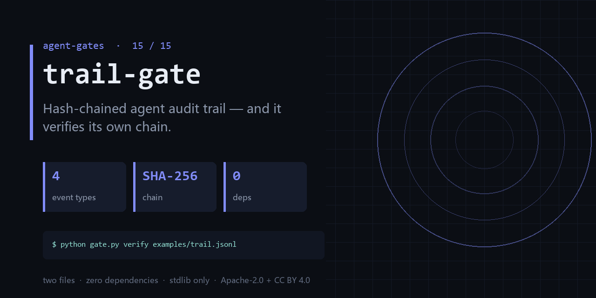

<div align="center">

</div>

<h1 align="center">trail-gate</h1>

<p align="center"><b>Hash-chained agent audit trail — and it verifies its own chain.</b><br><sub>one file · zero dependencies · stdlib only</sub></p>

<p align="center"><a href="https://github.com/chenhz01/trail-gate/actions/workflows/gate.yml"></a>   </p>

---

## The failure this catches

- The postmortem log was missing the one step that mattered, and nobody could prove it was not edited.
- Four agents each wrote their own log, and the timelines do not line up.
- 'Rolled back' is the entire record of what the rollback actually undid.

One command, on a file you already have:

```bash
python gate.py append examples/trail.jsonl --type decision --payload {"action":"deploy"} && \
  python gate.py append examples/trail.jsonl --type tool_call --payload {"tool":"run_tests"} && \
  python gate.py verify examples/trail.jsonl
```

<details>
<summary><b>Real output</b> — produced by the bundled <code>examples/</code>, not a mock-up</summary>

```text
valid: True | events: 2 | errors: 0
```

</details>

## What it does

- Append-only JSONL where each event hashes the previous one.
- `verify` detects tamper, gaps, reordering, bad types, and broken rollback references.
- Rollback is a first-class event with a `ref` to the seq it undoes.

## What it does **not** do

- Local integrity only — it does not stop someone rewriting the whole file.
- No server, no signatures, no timestamp authority. Ship it to a WORM store if you need that.
- It records what you tell it; it does not observe your agent.

Being explicit here is cheaper than a wrong expectation later.

## Exit codes

`0` = chain intact. `1` = tamper, gap, reorder, bad type, or broken rollback. `2` = bad input. **The bundled example is a valid chain — it exits 0 on purpose.**

## Install

```bash
git clone https://github.com/chenhz01/trail-gate
cd trail-gate
python gate.py --help
```

Python 3.9+. Nothing to `pip install` — stdlib only.

## Use it in CI

```yaml
- name: trail-gate
  run: python gate.py verify examples/trail.jsonl
```

## Use it as a GitHub Action

`action.yml` is included, so you can call this repo directly as a composite action.

```yaml
# .github/workflows/gates.yml
- uses: actions/checkout@v4

- uses: chenhz01/trail-gate@v0.1.3
  with:
    # IMPORTANT: this path is inside YOUR repository.
    # The examples/ in this repo are NOT in your workspace — pass your own files.
    args: "verify path/to/trail.jsonl"
```

Pin the tag (`@v0.1.3`) rather than `@main` — `main` moves.
Check [Releases](https://github.com/chenhz01/trail-gate/releases) for the newest tag; `v0.1.0` predates the
fix that makes a mistyped path fail instead of silently passing.

If you omit `args`, the action only prints help and exits 0. It raises a warning
annotation — quoting this gate's own correct usage — so a green check is never
mistaken for "it inspected my files".


## 中文速览

**轨迹门** — 哈希链式 Agent 审计轨迹——而且它会验证自己的链。

- 出事要复盘，发现日志缺了最关键那一步，而且没人能证明它没被改过。
- 四个 Agent 各自写日志，时间线对不上。
- 回滚到底回滚了什么，只有一句「已回滚」。

一行命令：`python gate.py verify examples/trail.jsonl`

边界：Local integrity only — it does not stop someone rewriting the whole file.

## The gates

| # | gate | what it stops |
|---|---|---|
| 02 | **[loop-gate](https://github.com/chenhz01/loop-gate)** | Find where your agent looped, before it burns another run |
| 03 | **[permission-gate](https://github.com/chenhz01/permission-gate)** | Score how much more your agent can do than it should |
| 04 | **[context-gate](https://github.com/chenhz01/context-gate)** | Measure what truncation deletes, before the model starts guessing |
| 05 | **[instruction-gate](https://github.com/chenhz01/instruction-gate)** | Two of your instructions contradict each other. This finds them |
| 06 | **[output-gate](https://github.com/chenhz01/output-gate)** | Before AI-written text ships, run the four checks it always fails |
| 07 | **[memory-expiry-gate](https://github.com/chenhz01/memory-expiry-gate)** | Give every memory a TTL, then prove the expiry semantics actually hold |
| 08 | **[drift-gate](https://github.com/chenhz01/drift-gate)** | When embeddings drift, retrieval quietly rots. Fingerprint it |
| 09 | **[price-gate](https://github.com/chenhz01/price-gate)** | Your cost model is only as good as the price table under it |
| 10 | **[complexity-ceiling](https://github.com/chenhz01/complexity-ceiling)** | Per-file complexity budgets that fail the build instead of the reviewer |
| 11 | **[deadcode-gate](https://github.com/chenhz01/deadcode-gate)** | Quantify how much of the repo is dead, instead of guessing |
| 12 | **[docrot-gate](https://github.com/chenhz01/docrot-gate)** | Docs don't die at once. They rot one stale command at a time |
| 13 | **[leak-gate](https://github.com/chenhz01/leak-gate)** | Scan for internal detail before the doc leaves the building |
| 14 | **[backup-gate](https://github.com/chenhz01/backup-gate)** | A backup you have never verified is a rumor |
| 15 | **trail-gate** ← you are here | Hash-chained agent audit trail — and it verifies its own chain |

## License

- Code: **Apache-2.0** — see [LICENSE](LICENSE)
- Docs and example data: **CC BY 4.0** — see [LICENSE-SPEC](LICENSE-SPEC)

Attribution required when you redistribute the documentation; code can be used commercially
without a separate agreement. See [NOTICE](NOTICE).
